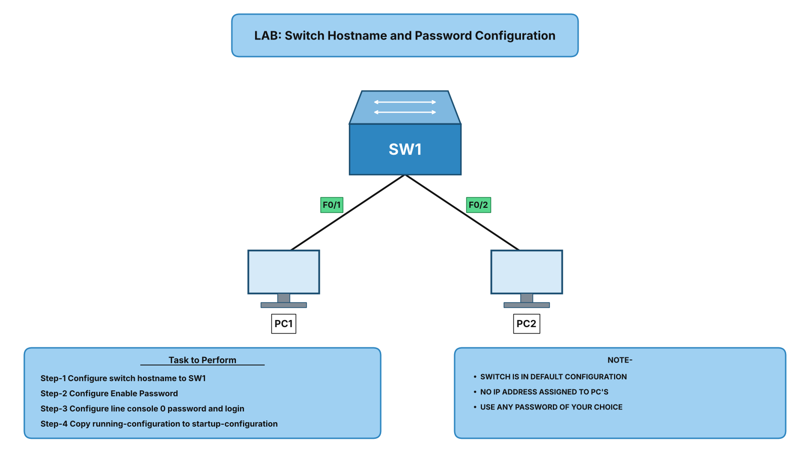

# 🔌 LAB: Basic Switch Configuration

## 🎯 Objective

- Connect two PCs to a switch and build a basic network.
- Change the default hostname of the switch to SW1.
- Secure privileged EXEC mode with an enable password.
- Secure console access with a line console 0 password.
- Verify the configuration and save it.

## 🖼️ Lab Topology

## 📋 Device Interface Table

| Device | Interface | Connected To | Notes |
|--------|-----------|--------------|-------|
| SW1 | Fa0/1 | PC1 (FastEthernet0) | Copper straight-through cable |
| SW1 | Fa0/2 | PC2 (FastEthernet0) | Copper straight-through cable |
| PC1 | NIC | SW1 Fa0/1 | 192.168.1.10 / 255.255.255.0 |
| PC2 | NIC | SW1 Fa0/2 | 192.168.1.20 / 255.255.255.0 |

## ⚙️ Configuration

### SW1 Configuration

**Enter privileged EXEC mode and global configuration mode**  
Switch> enable  
Switch# configure terminal  

**Change the hostname**  
Switch(config)# hostname SW1  

**Set the enable password**  
SW1(config)# enable secret Cisco123  

**Set the console line password**  
SW1(config)# line console 0  
SW1(config-line)# password Console123  
SW1(config-line)# login  
SW1(config-line)# exit  

**Save the configuration**  
SW1(config)# end  
SW1# copy running-config startup-config  

## ✅ Verification

**Check the configuration**  
SW1# show running-config  

**Check that the ports are up**  
SW1# show interfaces status  

**Test the console and enable passwords**  
Exit the CLI and log in again. SW1 should ask for the console password.  
Type enable. SW1 should ask for the enable password.  

**Test connectivity**  
From PC1, ping 192.168.1.20. The ping should succeed.  

## 🛠️ Troubleshooting

| Issue | Fix |
|-------|-----|
| Console password is not asked | Make sure the login command is configured under line console 0 |
| Ping between PCs fails | Check the IP addresses and subnet masks on both PCs |
| Switch ports are not green | Check the cables and wait for the ports to come up |
| Configuration is lost after reload | Save it with copy running-config startup-config |

## 🌍 Real-World Use Case

- Every new switch gets a proper hostname so it can be identified on the network.
- Passwords stop unauthorized users from changing the switch configuration.
- Console security protects the device against physical access.

## 📌 Outcome

- Hostname of the switch changed to SW1.
- Enable password configured for privileged EXEC mode.
- Console line password configured.
- Verified connectivity between PC1 and PC2.

## 🙏 Acknowledgment

- This lab is part of my CCNA 200-301 practice series. Thank you for taking the time to go through it.

## ✍️ Author's Note

- Prepared and documented by **Zakir Hussain** for CCNA lab practice and GitHub repository organization.

## ✅ Closing

- Thank you for reviewing this lab. Hands-on practice is the best way to learn networking.
