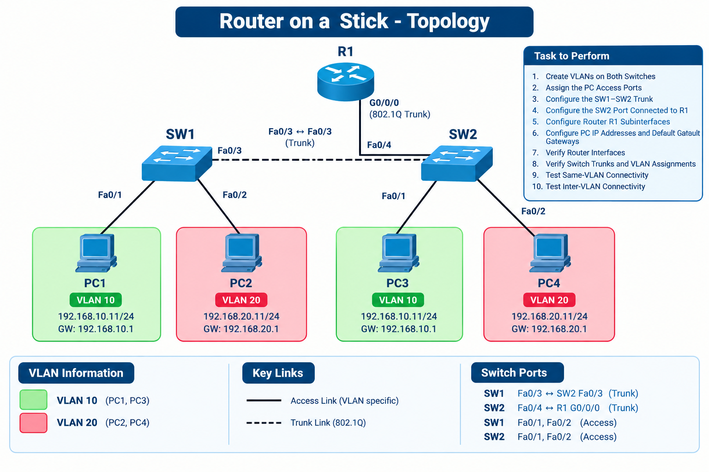

# 🌐 Lab: Router-on-a-Stick

## 🎯 Objective

- Build a network with two switches, four PCs, and router R1.
- Configure VLAN 10 (`IT`), VLAN 20 (`HR`), access ports, and both trunk links on SW1 and SW2.
- Add router R1 and configure an 802.1Q trunk between R1 and SW2.
- Configure router subinterfaces to provide a default gateway for each VLAN.
- Verify same-VLAN and inter-VLAN connectivity using ping tests.

## 🗺️ Lab Topology

The topology contains SW1 and SW2 connected by a trunk link, four PCs connected to access ports, and router R1 connected to SW2 Fa0/4. R1 provides inter-VLAN routing for VLAN 10 and VLAN 20. The topology image will be added here once it is ready.

<!-- Add the topology image here:  -->

## 🔌 Device Interface Table

| Device | Interface | Connected To | VLAN / Mode |
|--------|-----------|--------------|-------------|
| SW1 | Fa0/1 | PC1 (FastEthernet0) | VLAN 10 — Access |
| SW1 | Fa0/2 | PC2 (FastEthernet0) | VLAN 20 — Access |
| SW1 | Fa0/3 | SW2 Fa0/3 | Trunk — VLANs 10, 20 |
| SW2 | Fa0/4 | R1 G0/0/0 | Trunk — VLANs 10, 20 |
| SW2 | Fa0/1 | PC3 (FastEthernet0) | VLAN 10 — Access |
| SW2 | Fa0/2 | PC4 (FastEthernet0) | VLAN 20 — Access |
| SW2 | Fa0/3 | SW1 Fa0/3 | Trunk — VLANs 10, 20 |
| R1 | G0/0/0 | SW2 Fa0/4 | 802.1Q trunk |
| R1 | G0/0/0.10 | VLAN 10 | Gateway: 192.168.10.1/24 |
| R1 | G0/0/0.20 | VLAN 20 | Gateway: 192.168.20.1/24 |

## 🖧 IP Addressing Table

| Device | VLAN | IPv4 Address | Subnet Mask | Default Gateway |
|--------|------|--------------|-------------|-----------------|
| PC1 | VLAN 10 — IT | `192.168.10.2` | `255.255.255.0` | `192.168.10.1` |
| PC2 | VLAN 20 — HR | `192.168.20.2` | `255.255.255.0` | `192.168.20.1` |
| PC3 | VLAN 10 — IT | `192.168.10.3` | `255.255.255.0` | `192.168.10.1` |
| PC4 | VLAN 20 — HR | `192.168.20.3` | `255.255.255.0` | `192.168.20.1` |
| R1 G0/0/0.10 | VLAN 10 — IT | `192.168.10.1` | `255.255.255.0` | — |
| R1 G0/0/0.20 | VLAN 20 — HR | `192.168.20.1` | `255.255.255.0` | — |

## ⚙️ Configuration

### Step 1: Create VLANs on Both Switches

On **both SW1 and SW2**, create VLAN 10 for IT and VLAN 20 for HR.

Switch> enable  
Switch# configure terminal  
Switch(config)# vlan 10  
Switch(config-vlan)# name IT  
Switch(config-vlan)# exit  
Switch(config)# vlan 20  
Switch(config-vlan)# name HR  
Switch(config-vlan)# end

Verify on each switch:

show vlan brief

Expected: VLAN 10 named IT and VLAN 20 named HR appear on both switches.

### Step 2: Assign the PC Access Ports

Configure the PC-facing ports on each switch. On SW1, Fa0/1 connects to PC1 in VLAN 10 and Fa0/2 connects to PC2 in VLAN 20. On SW2, Fa0/1 connects to PC3 in VLAN 10 and Fa0/2 connects to PC4 in VLAN 20.

Apply the relevant commands on **SW1**:

Switch> enable  
Switch# configure terminal  
Switch(config)# interface fa0/1  
Switch(config-if)# switchport mode access  
Switch(config-if)# switchport access vlan 10  
Switch(config-if)# exit  
Switch(config)# interface fa0/2  
Switch(config-if)# switchport mode access  
Switch(config-if)# switchport access vlan 20  
Switch(config-if)# end

Apply the equivalent port configuration on **SW2**:

Switch> enable  
Switch# configure terminal  
Switch(config)# interface fa0/1  
Switch(config-if)# switchport mode access  
Switch(config-if)# switchport access vlan 10  
Switch(config-if)# exit  
Switch(config)# interface fa0/2  
Switch(config-if)# switchport mode access  
Switch(config-if)# switchport access vlan 20  
Switch(config-if)# end

Verify on both switches with `show vlan brief`. Expected: Fa0/1 is assigned to VLAN 10 and Fa0/2 to VLAN 20.

### Step 3: Configure the SW1–SW2 Trunk

The inter-switch connection is **SW1 Fa0/3 ↔ SW2 Fa0/3**. Configure Fa0/3 as a trunk on **both switches**, allowing VLANs 10 and 20.

Switch> enable  
Switch# configure terminal  
Switch(config)# interface fa0/3  
Switch(config-if)# switchport mode trunk  
Switch(config-if)# switchport trunk allowed vlan 10,20  
Switch(config-if)# no shutdown  
Switch(config-if)# end

Run these commands on **both SW1 and SW2**, then verify with:

show interfaces trunk

Expected: the SW1 Fa0/3 ↔ SW2 Fa0/3 link is trunking VLANs 10 and 20.

### Step 4: Configure the SW2 Port Connected to R1

Connect **SW2 Fa0/4** to **R1 G0/0/0**. On SW2, configure Fa0/4 as a trunk and allow VLANs 10 and 20.

Switch> enable  
Switch# configure terminal  
Switch(config)# interface fa0/4  
Switch(config-if)# switchport mode trunk  
Switch(config-if)# switchport trunk allowed vlan 10,20  
Switch(config-if)# no shutdown  
Switch(config-if)# end

Verify with `show interfaces trunk`. Expected: SW2 Fa0/4 is operating as a trunk and VLANs 10 and 20 are allowed.

### Step 5: Configure Router R1 Subinterfaces

On R1, enable the physical interface connected to SW2 and create one subinterface for each VLAN.

Router> enable  
Router# configure terminal  
Router(config)# interface gigabitEthernet0/0/0  
Router(config-if)# no shutdown  
Router(config-if)# exit

**Configure the VLAN 10 subinterface**

Router(config)# interface gigabitEthernet0/0/0.10  
Router(config-subif)# encapsulation dot1Q 10  
Router(config-subif)# ip address 192.168.10.1 255.255.255.0  
Router(config-subif)# exit

**Configure the VLAN 20 subinterface**

Router(config)# interface gigabitEthernet0/0/0.20  
Router(config-subif)# encapsulation dot1Q 20  
Router(config-subif)# ip address 192.168.20.1 255.255.255.0  
Router(config-subif)# exit  
Router(config)# end

### Step 6: Configure PC IP Addresses and Default Gateways

Open **Desktop → IP Configuration** on each PC and configure the following IP address, subnet mask, and default gateway:

- PC1 (VLAN 10): IP `192.168.10.2`, mask `255.255.255.0`, gateway `192.168.10.1`.
- PC3 (VLAN 10): IP `192.168.10.3`, mask `255.255.255.0`, gateway `192.168.10.1`.
- PC2 (VLAN 20): IP `192.168.20.2`, mask `255.255.255.0`, gateway `192.168.20.1`.
- PC4 (VLAN 20): IP `192.168.20.3`, mask `255.255.255.0`, gateway `192.168.20.1`.

### Step 7: Verify Router Interfaces

On R1, run:

show ip interface brief

show running-config

Expected: the physical interface is enabled, and subinterfaces G0/0/0.10 and G0/0/0.20 have their configured IP addresses. After the links come up, the subinterfaces should show an operational status.

### Step 8: Verify Switch Trunks and VLAN Assignments

On SW1 and SW2, run:

show interfaces trunk

Expected:
- SW1 Fa0/3 trunks VLANs 10 and 20 toward SW2.
- SW2 Fa0/4 trunks VLANs 10 and 20 toward R1.
- SW2 Fa0/3 trunks VLANs 10 and 20 toward SW1.

### Step 9: Test Same-VLAN Connectivity

From PC1, ping PC3:

ping 192.168.10.3

From PC2, ping PC4:

ping 192.168.20.3

Expected: both tests succeed because each pair belongs to the same VLAN and IP subnet.

### Step 10: Test Inter-VLAN Connectivity

From PC1, ping PC2:

ping 192.168.20.2

From PC4, ping PC3:

ping 192.168.10.3

Expected: both tests succeed. Traffic between VLAN 10 and VLAN 20 is routed through R1's subinterfaces.

## 🛠️ Troubleshooting

| Issue | Fix |
|-------|-----|
| Router subinterfaces are down | Check that the physical router interface is enabled with `no shutdown`, and verify the cable and connected switch port. |
| VLAN 10 or VLAN 20 is missing | Create VLAN 10 and VLAN 20 on both switches and verify with `show vlan brief`. |
| SW1–SW2 connectivity fails | Check the Fa0/3 trunk on both switches and allow VLANs 10 and 20. |
| R1 cannot route between VLANs | Verify `encapsulation dot1Q 10` and `encapsulation dot1Q 20`, the subinterface IP addresses, and the SW2 Fa0/4 trunk. |
| Same-VLAN ping fails | Verify PC IP addresses, subnet masks, access-port assignments, VLAN membership, and the SW1–SW2 trunk. |
| Inter-VLAN ping fails | Verify each PC's default gateway and confirm both router subinterfaces are operational. |

## 🌍 Real-World Use Case

- Router-on-a-Stick allows one physical router interface to route traffic for multiple VLANs using 802.1Q tagging.
- Separate VLANs can remain distinct broadcast domains while communicating through a Layer 3 device.
- Trunk links carry traffic for the required VLANs over a shared physical connection.

## 📌 Expected Result

- ✅ VLAN 10 (`IT`) and VLAN 20 (`HR`) are created on both switches.
- ✅ The SW1 Fa0/3 ↔ SW2 Fa0/3 trunk carries VLANs 10 and 20.
- ✅ R1 is connected to SW2 Fa0/4 using an 802.1Q trunk.
- ✅ R1 subinterfaces provide the default gateways for both VLANs.
- ✅ PCs in the same VLAN can communicate across the two switches.
- ✅ PCs in different VLANs can communicate through R1.

## 🙏 Acknowledgment

This lab demonstrates how to configure Router-on-a-Stick inter-VLAN routing using Cisco Packet Tracer. Thank you for taking the time to review it.

## ✍️ Author's Note

Prepared and documented by **Zakir Hussain** for CCNA lab practice and GitHub repository organization.

## ✅ Closing

- Thank you for reviewing this lab. Hands-on practice is the best way to learn networking.
